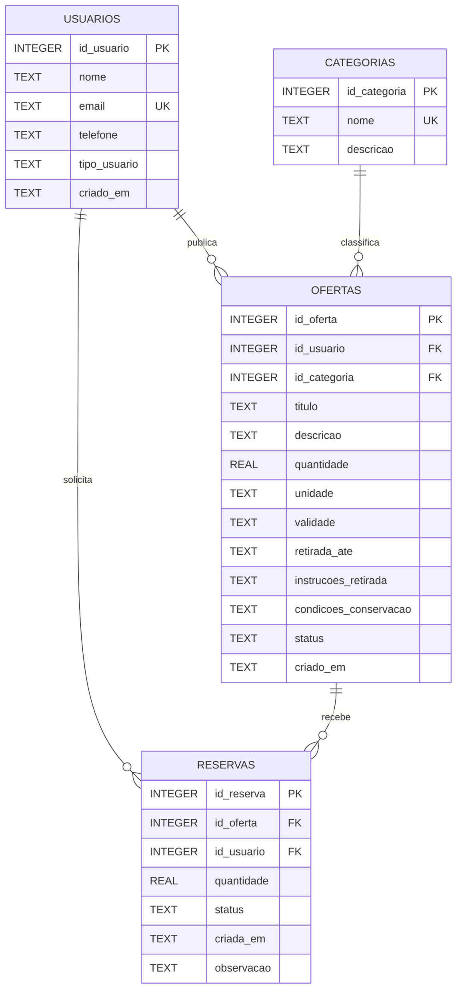

# Modelo Entidade-Relacionamento — ReVira

## 1. Diagrama ER

## 2. Entidades, colunas e tipos

### `usuarios`
| Coluna | Tipo SQLite | Regras |
|---|---|---|
| `id_usuario` | INTEGER | Chave primária autoincrementável |
| `nome` | TEXT | Obrigatório |
| `email` | TEXT | Obrigatório e único |
| `telefone` | TEXT | Opcional |
| `tipo_usuario` | TEXT | Obrigatório: `DOADOR`, `INTERESSADO` ou `AMBOS` |
| `criado_em` | TEXT | Data/hora de criação |

### `categorias`
| Coluna | Tipo SQLite | Regras |
|---|---|---|
| `id_categoria` | INTEGER | Chave primária autoincrementável |
| `nome` | TEXT | Obrigatório e único |
| `descricao` | TEXT | Opcional |

### `ofertas`
| Coluna | Tipo SQLite | Regras |
|---|---|---|
| `id_oferta` | INTEGER | Chave primária autoincrementável |
| `id_usuario` | INTEGER | FK para `usuarios.id_usuario` |
| `id_categoria` | INTEGER | FK para `categorias.id_categoria` |
| `titulo` | TEXT | Obrigatório |
| `descricao` | TEXT | Opcional |
| `quantidade` | REAL | Maior que zero |
| `unidade` | TEXT | Obrigatório, por exemplo `unidades`, `kg` ou `porções` |
| `validade` | TEXT | Data no formato `YYYY-MM-DD` |
| `retirada_ate` | TEXT | Prazo para retirada no formato ISO |
| `instrucoes_retirada` | TEXT | Obrigatório |
| `condicoes_conservacao` | TEXT | Obrigatório |
| `status` | TEXT | `ATIVA`, `RESERVADA`, `ENCERRADA` ou `VENCIDA` |
| `criado_em` | TEXT | Data/hora de criação |

### `reservas`
| Coluna | Tipo SQLite | Regras |
|---|---|---|
| `id_reserva` | INTEGER | Chave primária autoincrementável |
| `id_oferta` | INTEGER | FK para `ofertas.id_oferta` |
| `id_usuario` | INTEGER | FK para `usuarios.id_usuario` |
| `quantidade` | REAL | Maior que zero |
| `status` | TEXT | `ATIVA`, `CANCELADA`, `RETIRADA` |
| `criada_em` | TEXT | Data/hora da reserva |
| `observacao` | TEXT | Opcional |

## 3. Relacionamentos e cardinalidade

- **Usuários 1:N Ofertas:** um usuário pode publicar várias ofertas; cada oferta tem um responsável.
- **Categorias 1:N Ofertas:** uma categoria pode classificar várias ofertas; cada oferta pertence a uma categoria.
- **Usuários 1:N Reservas:** um usuário pode registrar várias reservas.
- **Ofertas 1:N Reservas:** uma oferta pode ter registros de reserva ao longo do tempo. A aplicação deve controlar a quantidade disponível para evitar reservas acima do estoque.

## 4. Restrições e regras de integridade

- Chaves primárias identificam unicamente cada registro.
- Chaves estrangeiras impedem referências a usuários, categorias ou ofertas inexistentes.
- O e-mail do usuário e o nome da categoria são únicos.
- Quantidades devem ser maiores que zero.
- Estados de usuário, oferta e reserva devem pertencer aos conjuntos permitidos.
- Uma oferta não pode ser reservada se estiver encerrada ou vencida.
- A aplicação deve validar que a quantidade reservada não exceda a quantidade disponível.
- Datas devem ser validadas antes de salvar.
- Exclusões de dados referenciados devem ser controladas para não apagar histórico relevante.
- Para o protótipo, a regra de disponibilidade será aplicada na lógica da aplicação dentro de uma transação.

## 5. Decisão sobre quantidades

Na versão inicial, cada oferta representa uma quantidade disponível. A aplicação calcula a quantidade restante subtraindo as reservas ativas. Se houver múltiplas reservas concorrentes no futuro, a operação deverá ser transacional no servidor compartilhado para evitar conflito entre dispositivos.
