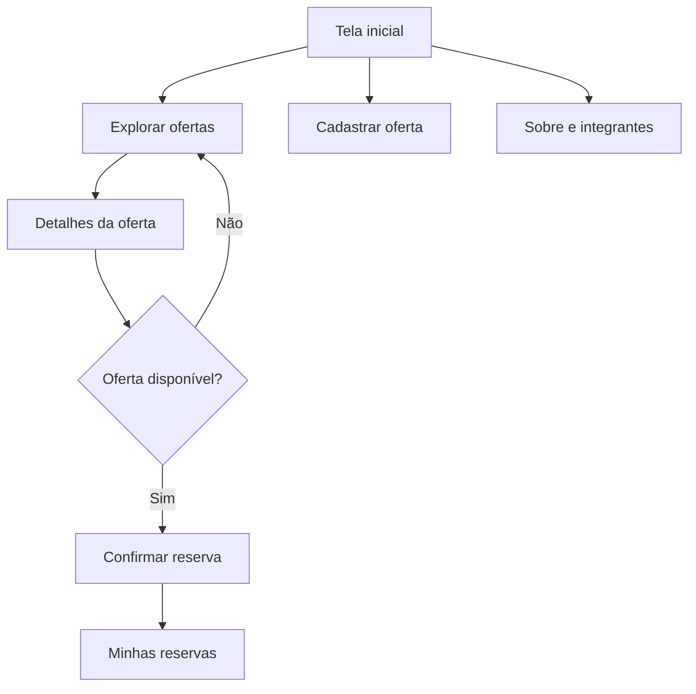

# Wireframes do ReVira

Os protótipos foram criados em SVG vetorial com prancheta de referência de **390 × 844 px**. Podem ser ampliados sem perda de qualidade e visualizados diretamente no navegador.

## Telas incluídas

1. [Início e resumo](../wireframes/01-inicio.svg)
2. [Explorar ofertas](../wireframes/02-explorar-ofertas.svg)
3. [Detalhes de oferta](../wireframes/03-detalhe-oferta.svg)
4. [Cadastrar oferta](../wireframes/04-cadastrar-oferta.svg)
5. [Minhas reservas](../wireframes/05-minhas-reservas.svg)
6. [Sobre e integrantes](../wireframes/06-sobre-integrantes.svg)

## Fluxo principal

## Notas de usabilidade

- A ação principal de cada tela deve estar visualmente destacada.
- Formulários devem indicar campos obrigatórios e mensagens de validação.
- Ofertas próximas da validade devem receber um aviso textual claro.
- Não usar apenas cores para indicar status; incluir também rótulos.
- A tela de detalhes deve mostrar validade, conservação e instruções de retirada antes da reserva.
- A tela de integrantes deve conter os nomes completos reais do grupo antes da entrega.
